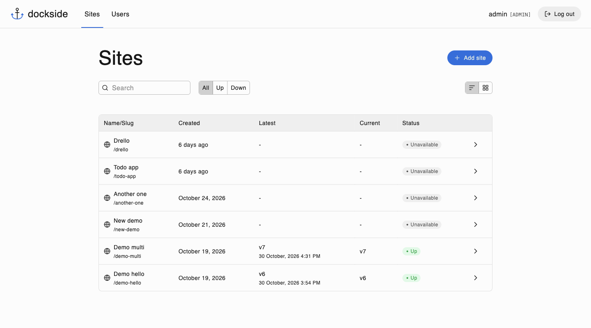
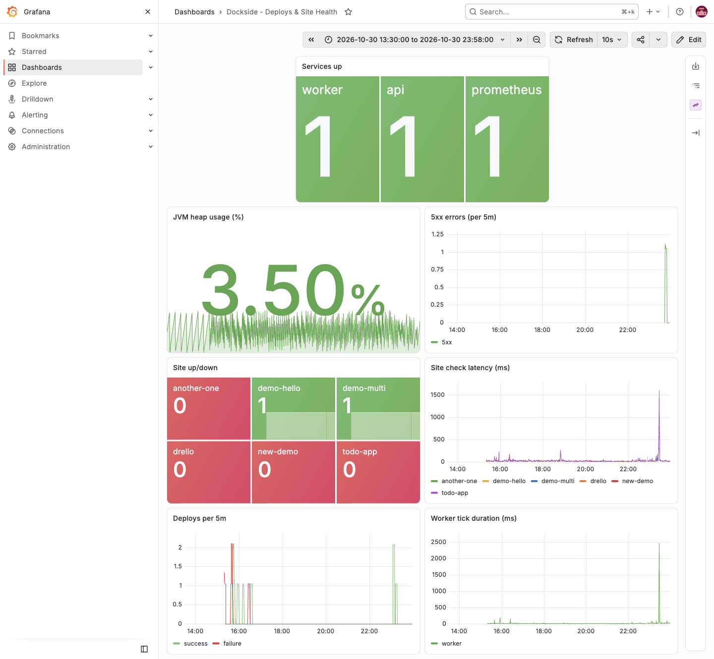
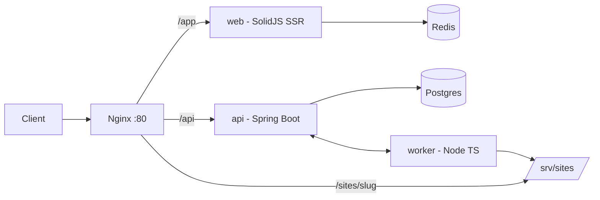

<picture>
  <source media="(prefers-color-scheme: dark)" srcset="docs/logo-dark.svg">
  
</picture>

# dockside

A minimal internal static-site hosting platform. Upload a zip, an HTML file, or a folder, get a versioned site served by Nginx, with rollbacks, health checks, and a small dashboard to manage it.

<br clear="left">





## Architecture



- **api** owns Postgres, auth, and the deployment queue. Uploaded artifacts are just rows pointing at files on disk.
- **worker** polls the api for jobs, publishes each artifact as a versioned directory.
- Health checks run on the worker and report up/down + latency back to the api, feeding the dashboard, Prometheus, and Grafana.
- The **CLI** lets you do everything the dashboard does, with support for structured json output, and stable error codes for automation and agents.

## Packages

| Path | What |
|---|---|
| [`web/`](./web/README.md) | SolidJS SSR dashboard|
| [`api/`](./api/README.md) | Spring Boot REST API|
| [`worker/`](./worker/README.md) | Node worker|
| [`cli/`](./cli/README.md) | `dockside` CLI|

Shared TypeScript packages live in `packages/`: [`api-client`](./packages/api-client) (typed client for the api) and [`deployment-config`](./packages/deployment-config) (parses `dockside.toml` deploy configs).

## Docs

- [RUNBOOK.md](./RUNBOOK.md) contains info on running dockside in prod: deploying the stack, first-boot bootstrap, backups/restore, secret rotation, troubleshooting.
- API docs: OpenAPI at `/v3/api-docs` on a running API.

## Prerequisites

- JDK 25 (api)
- Node (LTS) + pnpm
- Docker

## Development

```bash
# copy env and generate the two secrets it calls out (API_JWT_SECRET and WEB_SESSION_SECRET) using `openssl rand -base64 32`
cp .env.example .env

# start the backing infra; db, redis, prometheus, grafana, nginx
docker compose up -d

pnpm install

# start the services
pnpm start:api
pnpm dev:worker
pnpm dev:web
```

Tests: `pnpm test:api`, `pnpm test:worker`, `pnpm test:api-client`, `pnpm test:deployment-config`.

## Stack

- Java Spring Boot / Postgres + Flyway
- Node (worker, cli)
- SolidJS 2.0
- Commander CLI
- Nginx
- Redis
- Prometheus + Grafana
